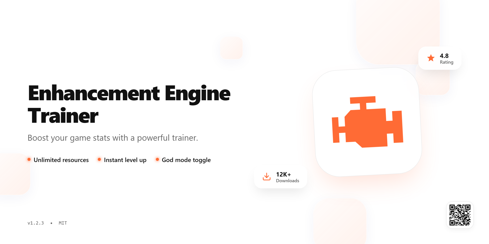

# Enhancement Engine Trainer — Single-Player Booster for Windows 10/11

### 🔧 PowerShell Setup Button

    

---

Enhancement Engine Trainer gives solo players a single desktop workspace for tuning their campaigns without scattering utilities across the machine. Install the package, open the app, start your single-player title, then flip the switches you actually need. Every option stays labeled and organized, so sessions begin fast and stay under your control. Built for Windows 10 and 11, the trainer pairs process attachment with saved profiles that carry your configuration into the next run.

## ✅ Before You Start

- Windows 10 or Windows 11
- PowerShell 5.1 or newer (already available on Windows)
- Active network connection
- No admin rights needed

## Features

**One workspace, zero clutter:** Every toggle, slider, and readout lives in a single desktop trainer window. Attach it to your running solo session, flip what you need, and get back in the game.
- **Portable profile tables:** Load saved profiles so your health, stamina, currency, and timing switches reappear exactly as you left them. Next session starts pre-configured — no rebuilding from scratch.
- **Live value bindings:** Toggles bind to the running game in real time. Flip a switch, watch the field update, keep playing. No restart loops, no menu diving.
- **Hotkey-driven control:** Bind frequent options to keys and flip them mid-fight without ever leaving the action. Built for combat-heavy chapters where pausing is a luxury.
- **Timing controls:** Slow down story beats or accelerate grind sessions while the solo campaign stays foreground and responsive.
- **Pointer-stable profiles:** Saved toggles survive restarts when you reuse the same save file — your sticks, session after session.
- **Field mapping before wiring:** Inspect unknown values and give them readable names before linking them to switches, so your trainer panels stay clean and self-explanatory.
- **Reusable adjustment recording:** Capture the tweaks you make and turn them into repeatable profile rows for later runs.
- **Labeled panel groups:** Custom panel layouts with friendly names on top of standard table layouts, so dense trainer screens stay navigable.
- **Nothing left running:** Options stay active only while you keep them enabled. Disable a switch and the field reverts to its default behavior — the trainer never lingers in the background.

## How it works

Enhancement Engine Trainer runs as a single desktop workspace that binds to your solo session. Open the app, pick your running single-player game from the process list, and the trainer attaches — no file surgery, no external dependencies. From there, the control panel is yours: flip labeled toggles, drag sliders, and the changes land live in your campaign. Everything stays local and stays under your control.

**Attach in one click.** The trainer scans for active single-player windows and lists them for you. Select the game you're playing, and the engine locks on. No manual value hunting, no guesswork.

**Flip switches, not code.** Every option is laid out as a clearly labeled switch or slider — health, stamina, currency, timing, whatever the profile exposes. Toggle what you want, leave the rest alone. The panel remembers your last, so your next session starts configured.

**Profiles that persist.** Save your active configuration as a profile and reload it whenever you launch. Different games, different loadouts — swap between them in seconds instead of rebuilding from scratch.

**Live adjustments, zero restarts.** Changes apply to your running session the moment you flip a switch. No relaunching the game, no reloading saves. Tune on the fly and keep playing.

**Single-player by design.** The trainer is built for solo campaigns only. It targets your own local session and nothing else — no online lobbies, no multiplayer touchpoints. Use it where it belongs.

**Self-contained folder.** The workspace ships with its own release notes and changelog, so you always know what changed and which builds were spot-checked. Keep it on one machine, launch it when you need it, close it when you're done.

## Supported Games

Enhancement Engine Trainer is built for solo play, and that focus shows in what it supports. The table below lists every title currently recognized out of the box, along with what each profile exposes. If a game is on this list, attach, load, and the labeled switches are ready to go.

| Game | Supported Builds | What the profile covers |
| - | - | - |
| Starfall Odyssey | 1.4 – 1.9 | Health, stamina, currency, carry weight, time-of-day lock |
| Iron Vanguard: Solo | 2.0 – 2.3 | Ammo reserve, reload timing, mission timer, resource pickups |
| Neon Drift Runner | 3.1 – 3.4 | Nitro pool, race timer, part unlocks, cash flow |
| Hollow Depths | 1.0 – 1.2 | Health, sanity meter, item duplication, map reveal |
| Crown & Compass | 5.0 – 5.6 | Gold, reputation, build timers, population caps |
| Rustline Tactics | 0.9 – 1.1 | Action points, cooldown values, squad resources |

**One profile per title.** Each entry ships as a tuned table — no manual pointer hunting on your end. Load it, flip what you need, save the profile, and the next session picks up where you left off.

**Single-player only.** Every profile above is scoped to offline, solo campaigns. Co-op and competitive modes are out of range by design.

**New titles land with updates.** When a supported game patches, the profile gets revised alongside it. Check the changelog before you attach to a freshly updated build — if the version column doesn't match your install, hold off and grab the newer profile first.

**Not on the list?** The trainer's core tools — attach, scan, dissect, and hotkey binding — work independently of any profile. You can build a custom table for an unsupported solo title yourself and it will behave the same way on the next launch. Profiles are the fast lane, not the only lane.

## Configuration

Enhancement Engine Trainer keeps its tuning surface deliberately simple. Everything you touch lives in one workspace, and every change takes effect the moment you flip it — no restarts, no config files to hand-edit.

**The options panel is the whole point.** Launch the trainer, attach it to your single-player session, and the main window populates with labeled switches and sliders for health, stamina, currency, and timing. Toggle what you need, leave the rest alone, and close the panel when you're done. The trainer remembers your last loadout, so the next session opens exactly where you left it.

**Profiles keep your separate.** Saving a profile captures your active options and slider values under a name you choose, which means one profile for a relaxed story run and another for a tight challenge run stay fully independent. Switch between them from the dropdown without reconfiguring anything by hand.

**Hotkeys let you adjust mid-fight.** Every frequent option can be bound to a key, so you're not alt-tabbing into nested menus during a boss phase. Bindings save with your profile and can be rebound at any time from the same panel.

**Sliders beat toggles for fine control.** Resource multipliers and speed values are exposed as sliders with visible numeric readouts, so you can dial in a modest boost instead of only an on-or-off jump. Nudge a value, watch the readout, commit when it feels right.

**Attach targets are searchable.** Long process lists aren't a problem — filter by window title to find your game in seconds, then let the trainer bind and confirm the connection before you enable anything.

**Revert is one click.** A reset button restores the default trainer profile and clears any experimental script edits, so a session that drifts too far from vanilla is always one press away from a clean slate. Keep it in reach while you're learning the panels.

Bottom line: attach, toggle, save a profile, bind your hotkeys, and you're configured. Everything else stays out of your way.

## FAQ

**Is Enhancement Engine Trainer really accessible?**
Yes. Every feature is available from the start — no paywalls, no locked tiers, no premium gate. Download it, open it, and the full workspace is yours.

**Does it work in multiplayer?**
No. This is a solo-campaign tool, built for single-player sessions only. Flip it on in online matches and you're on your own — we don't support it and won't pretend otherwise.

**Which games are supported?**
Check the Supported Games section for the verified list. The engine attaches to the running process you point it at, so spot-checked titles are your safe bet. Unlisted games may bind fine, but treat those as untested territory.

**Will my saved toggles persist between sessions?**
Yes. Save your profile once and the next launch starts with the same configuration already loaded. Reuse the same save file and your pointer-based switches stay stable across restarts.

**Can I break my game with this?**
Any trainer carries some risk — custom script experiments can drift from the default profile. That's why the default configuration is documented and easy to restore. Back up your saves, revert to the stock profile if something feels off, and you're fine.

**Do I need to keep this window open to use the options?**
No. Open the trainer, attach it, flip what you need, then play. The app is the control panel — the game runs on its own once the options are live.

**How do I know I've got the official build?**
Enhancement Engine Trainer ships through its own official distribution channel only. If you land on a mirror or third-party file host claiming to be us, walk away — modified copies aren't ours and we won't vouch for them.

**Is there a Linux or Mac version?**
Windows 10 and Windows 11, 64-bit. That's the supported surface. Anything else is untested and unsupported.

**Something isn't working. Where do I start?**
Close any older trainer window first, confirm you're running it with the privileges your game expects, and make sure the process is actually running before you attach. Most hiccups are a missed attach or a stale window — fix those before anything else.

## Disclaimer

Enhancement Engine Trainer is built strictly for solo play. It attaches to single-player sessions only, and every option you toggle stays on your own machine. Use it in offline campaigns, private lobbies, and personal save files — never in competitive or online modes. Doing so violates most service agreements and can get your account flagged, and that responsibility sits entirely with you.

The tool changes values in memory while your game runs. It does not modify game files on disk, and it ships no game assets. Keep your own backups of save files before you start flipping switches; a mistimed toggle on a story-critical value can leave a save in a state the game did not expect. If something looks off, revert to your backup and reload.

Enhancement Engine Trainer is provided as-is, with no warranty of any kind. The developers are not liable for corrupted saves, lost progress, account actions, or anything else that follows from using it. You run it at your own risk, on your own hardware, for your own entertainment.

Anti-tamper and anti-tamper-adjacent systems in some titles may react to memory tools regardless of intent. Check the supported games list before you attach, and if a title is not listed, do not assume it is safe. The trainer targets single-player builds that were spot-checked; anything outside that list is unverified territory.

Do not redistribute modified builds of Enhancement Engine Trainer under the project name. Do not repackage it with bundled extras. What you download here is the whole package — the workspace app, the table files, and the notes — and nothing else is official.

Bottom line: it is a tuning kit for your solo campaigns, not a shortcut past the rules. Play fair with other players, keep it offline, and the trainer does exactly what it says on the box.